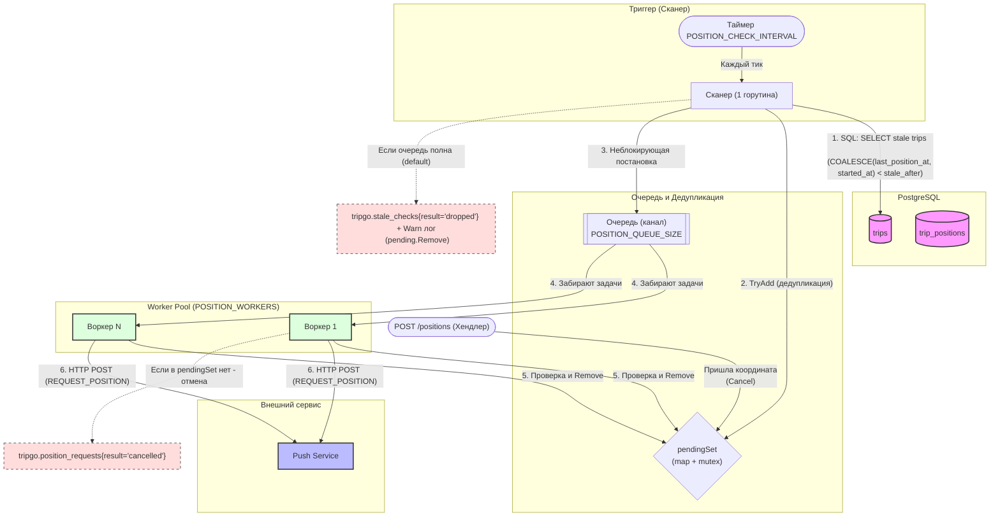

# TripGo: лабораторная работа 3

HTTP-cервис поездок.

## Требования

- Go 1.24+
- tripgoctl
- Docker
- make

## Запуск

### 1. Поднять окружение
```sh
tripgoctl cluster start
tripgoctl environment start
tripgoctl connect
```

### 2. Накатить миграции
```sh
make migrate
```

### 3. Запустить сервис
```sh
make run
```

### Другие команды `make`

- `make generate`: кодогенерация из OpenAPI (в `internal/generated/api.gen.go`)
- `make migrate-down`: откатить последнюю миграцию
- `make migrate-status`: статус миграций
- `make test`: запустить unit-тесты с -race и выводом покрытия
- `make test-integration`: запустить интеграционные тесты (требуется поднятая БД)
- `make lint`: запустить golangci-lint (линтер)

## Переменные окружения (см. `.env.example`)

| Переменная | Описание |
|---|---|
| `HTTP_ADDR` | адрес HTTP-сервера, например `:8080` |
| `DATABASE_URL` | строка подключения к PostgreSQL |
| `DATABASE_MAX_CONNS` | максимальный размер пула |
| `DATABASE_MIN_CONNS` | минимальный размер пула |
| `DATABASE_MAX_CONN_LIFETIME` | время жизни соединения |
| `DATABASE_CONNECT_TIMEOUT` | таймаут установки соединения |
| `DATABASE_QUERY_TIMEOUT` | таймаут одного запроса к БД |
| `SHUTDOWN_TIMEOUT` | таймаут для graceful shutdown |

Опциональные:

| Переменная | По умолчанию | Описание |
|---|---|---|
| `LOG_LEVEL` | `info` | уровень логирования |
| `HTTP_READ_TIMEOUT` | `10s` | таймаут чтения запроса |
| `HTTP_READ_HEADER_TIMEOUT` | `5s` | таймаут чтения заголовков |
| `HTTP_WRITE_TIMEOUT` | `15s` | таймаут записи ответа |
| `HTTP_IDLE_TIMEOUT` | `60s` | таймаут простоя соединения |

Телеметрия:

| Переменная | Описание |
|---|---|
| `OTEL_SERVICE_NAME` | имя сервиса в телеметрии (атрибут `service.name`) |
| `OTEL_EXPORTER_OTLP_ENDPOINT` | адрес OTel Collector для экспорта по OTLP |
| `OTEL_EXPORTER_OTLP_PROTOCOL` | протокол экспорта |
| `OTEL_TRACES_SAMPLER` | стратегия сэмплирования трейсов |
| `OTEL_RESOURCE_ATTRIBUTES` | дополнительные атрибуты ресурса |

Фоновые компоненты:

| Переменная | Описание |
|---|---|
| `POSITION_CHECK_INTERVAL` | период тикера сканера |
| `POSITION_STALE_AFTER` | через какое время, проведенное без координат, поездка считается устаревшей |
| `POSITION_WORKERS` | количество воркеров |
| `POSITION_QUEUE_SIZE` | ёмкость очереди задач |
| `PUSH_HTTP_URL` | адрес Push Service |
| `PUSH_REQUEST_TIMEOUT` | таймаут запроса в Push Service |

## API

| Метод | Путь | Назначение |
|---|---|---|
| `POST` | `/api/v1/trips` | создать поездку |
| `GET` | `/api/v1/trips/{tripId}` | получить поездку |
| `POST` | `/api/v1/trips/{tripId}/finish` | завершить поездку |
| `GET` | `/health` | проверить работоспособность сервера |
| `GET` | `/ready` | проверить подключение к БД |
| `POST` | `/api/v1/trips/{tripId}/positions` | сохранить координату |
| `GET` | `/api/v1/trips/{tripId}/positions` | получить маршрут |

## Архитектура и слои

- `internal/domain`: доменные модели (`Trip`), бизнес-правила для доменных моделей (переход статусов, валидация) и доменные ошибки (`ErrTripNotFound`, `ErrDriverBusy` и т.д.).

   *Зависимости:* не зависит от транспортного слоя, БД и других компонент, импортирует только стандартную библиотеку.

- `internal/usecase`: бизнес-логика. Принимает сырые данные, вызывает методы домена, оборачивает операции записи в транзакции.

   *Зависимости:* зависит от интерфейсов репозиториев и менеджера транзакций (объявлены в `contract.go` рядом с юзкейсом). Не зависит от транспортного слоя и не импортирует БД напрямую.

- `internal/http`: транспортный слой. Содержит хендлеры, middleware и маппер ошибок (`domainerror`). Преобразует HTTP-запросы в вызовы юзкейсов и обратно.

   *Зависимости:* зависит от `internal/usecase` и `internal/generated` (типы из OpenAPI). Не импортирует `internal/repository` и `internal/infra` напрямую.

- `internal/repository`: реализация доступа к PostgreSQL через `pgx` и `squirrel`.

   *Зависимости:* зависит от `internal/domain` (чтобы возвращать доменные ошибки) и `internal/infra/postgres/transaction` (для работы с `DBTX`). Не содержит бизнес-логики.

- `internal/infra`: инфраструктурные компоненты (пул pgxpool, менеджер транзакций, инициализация OpenTelemetry, настройка логгера).

   *Зависимости:* зависит от `internal/config` и внешних библиотек.

- `internal/container`: composition root. Создает и связывает все зависимости (пул, репозитории, юзкейсы, хендлеры, роутер) и передает их в main.

   *Зависимости:* зависит от всех остальных пакетов. Здесь создаются конкретные реализации (например, `pgxpool.New` и репозитории).

- `internal/gateway/push`: HTTP-клиент для Push Service. Интерфейс объявлен у потребителя (`worker/positions`).

- `internal/worker/positions`: сканер, `pendingSet`, worker pool. Зависит от интерфейсов репозитория, gateway и метрик.

- `internal/model`: общие структуры между слоями (`StaleTrip`).

### Где объявлены интерфейсы и почему

Интерфейсы зависимостей объявлены там, где они используются (в пакетах `usecase`), а не там, где реализуются (в `repository` или `infra`).

1. **Интерфейсы в `usecase`**: в файлах `contract.go` рядом с юзкейсами (например, `internal/usecase/trip/create/contract.go`) объявлены узкие интерфейсы `tripRepository` и `txManager`.

   *Почему там:* юзкейс как потребитель формулирует, что именно ему нужно от базы данных (например, только метод `Save`). Это делает код гибким, упрощает мокирование в тестах и позволяет менять реализацию БД без изменения бизнес-логики.

2. **Интерфейс `DBTX`**: объявлен в `internal/infra/postgres/transaction`.

   *Почему там:* он является инфраструктурной абстракцией над пулом и транзакцией. Репозиторий использует его, чтобы не знать, работает ли он в транзакции или напрямую с пулом.

Правильность направления зависимостей проверяется линтером `depguard` (правила описаны в `.golangci.yml`).

## Опрос устаревших поездок



- Сканер — одна фоновая горутина. На каждом тике (`POSITION_CHECK_INTERVAL`) выполняет один SQL-запрос: выбирает active-поездки, у которых `COALESCE(last_position_at, started_at)` старше `POSITION_STALE_AFTER`. Сортировка - от самых давно молчащих.

- Дедупликация - перед постановкой в очередь сканер проверяет `pendingSet` (map под mutex). Если поездка уже там - `tripgo.stale_checks{result="duplicate"}`, повторно не ставим.

- Очередь - буферизованный канал на `POSITION_QUEUE_SIZE` задач.

- Воркеры - `POSITION_WORKERS` горутин. Читают задачу, проверяют, что она всё ещё в `pendingSet` (если нет - значит, пришла координата, result="cancelled"), убирают из `pendingSet`, ходят в Push Service с таймаутом `PUSH_REQUEST_TIMEOUT`.

- Отмена координатой - при успешном `POST /positions` usecase вызывает `pendingSet.Cancel(trip_id)`. Задача, которая уже в канале, при обработке отбрасывается.

Что произойдёт при исчерпании очереди:

Если канал полон, сканер не блокируется: поездка не ставится в очередь, из `pendingSet` удаляется, инкрементится `tripgo.stale_checks{result="dropped"}`, пишется Warn-лог. Поездка не теряется: она остаётся устаревшей в БД и попадёт в выборку на следующем тике.

## Принятые в этой работе решения

### Индекс под stale-выборку

```sql
CREATE INDEX CONCURRENTLY IF NOT EXISTS trips_stale_check_idx
   ON trips (COALESCE(last_position_at, started_at))
   WHERE status = 'active';
```

### Сканер и очередь

- Сканер - одна горутина с time.Ticker, тики не накладываются: scan вызывается синхронно в select, следующий тик ждёт завершения предыдущего.

- Таймер подменяем через интерфейс Ticker и TickerFactory, в тестах - MockTicker.

- Очередь - буферизованный канал, постановка неблокирующая (select с default). При переполнении - dropped + Warn, pending.Remove.

- Дедупликация - `pendingSet` (map + sync.Mutex), доступен сканеру, воркерам и хендлеру координаты.

### Сохранение координаты

- `INSERT` в `trip_positions` + `UPDATE trips.last_position_at` в одной транзакции через TxManager.

- `last_position_at` обновляется через `GREATEST(COALESCE(last_position_at, $1), $1)` - старая координата не состарит поездку, сравнение в SQL, не в Go.

- Если UPDATE вернул 0 rows (поездка completed или удалена) - дочитываем через GetByID, различаем 404/409, транзакция откатывается.

### Worker pool и остановка

- `POSITION_WORKERS` воркеров, фиксированное число, запускаются при старте.

- `pending.Remove` - в двух местах: воркер (до запроса в Push) и хендлер координаты (через positionCanceller).

- При остановке: `workerCancel` → сканер завершился → `close(queue)` → воркеры drain в рамках внешнего `SHUTDOWN_TIMEOUT` (передаётся из main через `StopWorkers(ctx)` / `SetDrainContext`) → `workerWG.Wait()`. drain использует `context.WithoutCancel` + внешний дедлайн, не создаёт свой таймер.

- `goleak.VerifyTestMain` в `worker/positions`.

## Принятые решения (ЛР 2)

### Архитектура и изоляция слоёв

- Все зависимости направлены внутрь.

- Интерфейсы объявлены на стороне потребителя (в пакетах `usecase`), что позволяет легко мокать их в тестах и отвязывает бизнес-логику от реализации.

- Ошибки маппятся в application/problem+json в одном месте (`internal/http/domainerror`).

### Телеметрия

- Имя сервиса читается из `OTEL_SERVICE_NAME` в конфиге, остальные переменные OTel SDK читает сам из .env.

- Для добавления `trace_id` в логи используется кастомный `traceHandler`, который переопределяет `WithAttrs`.

- Для корректной работы `Tracing` я отказалась от использования `otelhttp`, т.к. его неудобно применять, если требуются шаблонные маршруты и кастомное отображение ошибок в спанах (бизнес-ошибки я также отмечаю в корневом спане). Используется `statusRecorder` с начальным статусом 0 (чтобы перехватывать 4xx и 5xx ошибки).

- Если коллектор недоступен, сервис продолжает работать, а ошибки экспорта логируются.

## Принятые решения (ЛР 1)

### Уровень изоляции

`Read Committed`. 

Причины выбора:

- создание поездки защищено от гонки частичным уникальным индексом;
- завершение поездки защищено от гонки условием `WHERE status = 'active'` в `UPDATE`;
- более строгая изоляция избыточна, при этом нужно будет учитывать возможность ошибки сериализации.

### Менеджер транзакций

`Manager` реализует интерфейс `TxManager` c методом `Do`. `Do(ctx, fn)` открывает транзакцию и кладёт её в контекст.
Репозиторий выбирает исполнителя запроса через `db.GetExecutor(ctx, r.pool)`; этот метод возвращает объект интерфейса `DBTX` (транзакцию, если она лежит в контексте, иначе пул соединений).
Таким образом репозиторий не знает, через что выполняет запросы.

Создание поездки пишет в `trips` и `trip_status_history` в одном методе репозитория, который handler оборачивает в транзакцию.
Если второй `INSERT` падает, первый откатывается.

### Запрет двух активных поездок у водителя

Частичный уникальный индекс:

```sql
CREATE UNIQUE INDEX trips_one_active_for_driver_idx ON trips (driver_id)
   WHERE status = 'active';
```

Это ограничение на уровне БД, при котором из двух параллельных `INSERT` поездки для одного и того же `driver_id` успешно выполнится только один запрос, а второй получит `23505 (unique_violation)`.